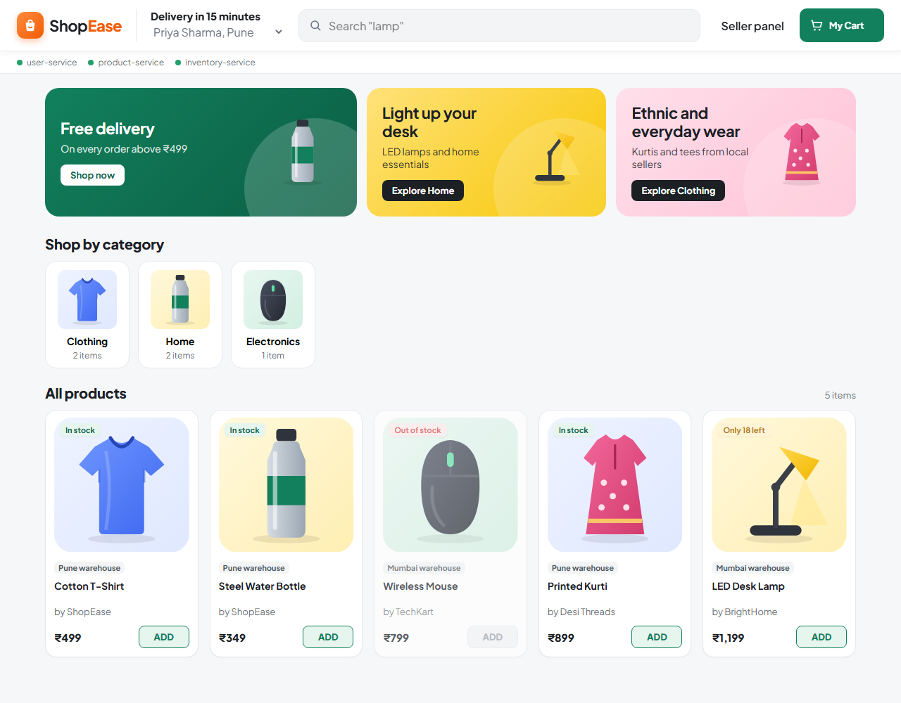
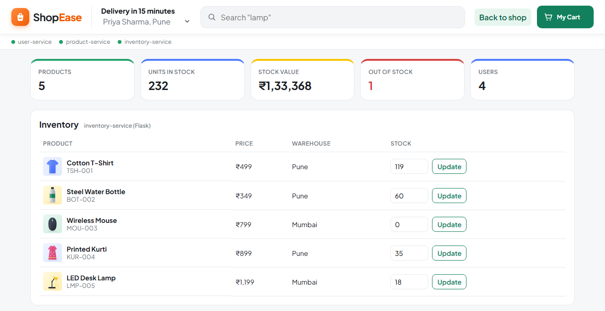
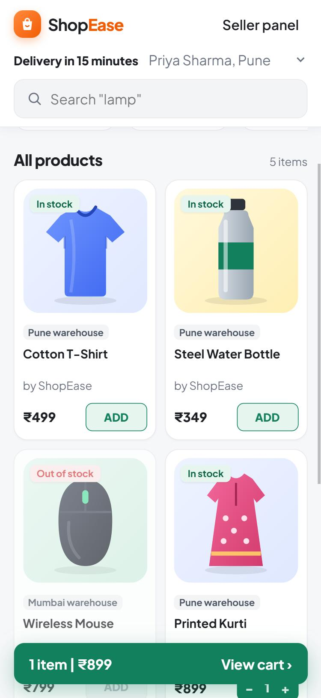

# ShopEase: E-Commerce Marketplace with Microservices and Docker

[](https://github.com/Abhxym/ecommerce-microservices-docker/actions/workflows/ci.yml)

Case Study 9 (Cloud Native DevOps, MDM). A small online marketplace split into four microservices
in three languages, with a shared MySQL database and a React storefront.
Everything runs in Docker containers and is started with one `docker compose up`.



## Contents

1. [Overview](#1-overview)
2. [Architecture](#2-architecture)
3. [Screenshots](#3-screenshots)
4. [Project structure](#4-project-structure)
5. [Getting started](#5-getting-started)
6. [Using the application](#6-using-the-application)
7. [API reference](#7-api-reference)
8. [Q1: Dockerfiles](#8-q1-dockerfiles)
9. [Q2: Docker Compose and service dependencies](#9-q2-docker-compose-and-service-dependencies)
10. [Q3: product-service cannot connect to inventory-service](#10-q3-product-service-cannot-connect-to-inventory-service)
11. [Q4: Upgrade MySQL without losing data](#11-q4-upgrade-mysql-without-losing-data)
12. [Testing and CI](#12-testing-and-ci)
13. [Demo script](#13-demo-script)
14. [Troubleshooting](#14-troubleshooting)
15. [How we work](#15-how-we-work)

## 1. Overview

| Container | Stack | Port | Health check | Image size |
|---|---|---|---|---|
| `user-service` | Java 21, Spring Boot 3, Spring Data JPA | 8081 | `GET /actuator/health` | 383 MB |
| `product-service` | Node.js 20, Express, mysql2 | 8082 | `GET /health` | 205 MB |
| `inventory-service` | Python 3.12, Flask, gunicorn, PyMySQL | 8083 | `GET /health` | 188 MB |
| `order-service` | Node.js 20, Express, mysql2 | 8085 | `GET /health` | 205 MB |
| `web-ui` (ShopEase) | React 18, Vite, nginx | 8080 | `GET /healthz` | 74 MB |
| `marketplace-mysql` | MySQL 8.4 | 3306 (host 3307) | `mysqladmin ping` | official image |

What each service owns:

- **user-service**: customers. List, get by id, register with validation and duplicate email check. Table `users`.
- **product-service**: product catalogue. For a single product it also calls inventory-service and adds the stock. Table `products`.
- **inventory-service**: stock per product and warehouse. Read, update, reserve and release quantity. Table `inventory`.
- **order-service**: orders. Checks the user, takes prices from product-service, reserves stock in inventory-service and saves the order. Cancel gives the stock back. Tables `orders`, `order_items`.
- **web-ui**: the ShopEase storefront (shop, cart, My orders) and a Seller panel (stock, users). It only talks to the services through its own nginx.

Each service reads and writes only its own table. Database settings always come from environment variables, never from code.

## 2. Architecture

```
                                     Browser
                                        |  http://localhost:8080
                                        v
                      +-----------------------------------+
                      |  web-ui: nginx + React (ShopEase) |
                      |  /api/users      /api/products    |
                      |  /api/inventory  /api/orders      |
                      +-----------------+-----------------+
                                        |
       +------------------+-------------+--------------+--------------------+
       v                  v                            v                    v
+--------------+  +-----------------+  stock  +-------------------+  +----------------+
| user-service |  | product-service |-------->| inventory-service |  | order-service  |
| Spring :8081 |  | Express :8082   |         | Flask :8083       |  | Express :8085  |
+------+-------+  +--------+--------+         +---------+---------+  +-------+--------+
       ^                   ^                            ^                    |
       |                   |  price                     |  reserve/release   |
       +-------------------+----------------------------+--------------------+
                                order-service calls the other three

       users              products                    inventory            orders, order_items
       +-------------------+----------------------------+--------------------+
                                        v
                            +-----------------------+
                            |  MySQL 8.4  :3306     |
                            |  volume: mysql-data   |
                            +-----------------------+

        All containers are on the bridge network "marketplace-net" and find each other by service name.
```

| Caller | Calls | Why |
|---|---|---|
| web-ui (nginx) | all four services | the browser only talks to `localhost:8080` |
| product-service | inventory-service `GET /api/inventory/{id}` | add the stock to a product |
| order-service | user-service `GET /api/users/{id}` | does the customer exist, delivery city |
| order-service | product-service `GET /api/products/{id}` | real name and price |
| order-service | inventory-service `POST .../reserve`, `.../release` | take or give back stock |

A request for one product (`GET /api/products/1`) goes browser, nginx, product-service. product-service reads
the product from MySQL, then calls `http://inventory-service:8083/api/inventory/1` and returns both together:

```json
{ "id": 1, "sku": "TSH-001", "name": "Cotton T-Shirt", "category": "Clothing", "price": 499,
  "seller": "ShopEase", "stock": { "quantity": 120, "warehouse": "Pune", "inStock": true } }
```

If inventory-service cannot be reached, product-service retries 3 times and then returns the product with
`"stock": null` instead of failing. The storefront then shows "Stock unavailable".

Placing an order (`POST /api/orders`) is a small **Saga** across three services. There is no shared
transaction, so each step that changed another service has an undo step:

```
check user (user-service) -> read prices (product-service) -> reserve stock item by item (inventory-service)
   -> save order and items in one MySQL transaction -> 201 CONFIRMED
an item cannot be reserved (409) or saving fails  ->  release everything already reserved
```

## 3. Screenshots

| Seller panel | Phone layout |
|---|---|
|  |  |

## 4. Project structure

```
ecommerce-microservices-docker/
|-- user-service/              Spring Boot service (Jagdish)
|   |-- src/main/java/...      controller, entity, repository, DTOs, exception handler
|   |-- src/test/java/...      MockMvc tests on an in-memory H2 database
|   |-- Dockerfile             Maven build, JRE runtime, non-root user
|   `-- user-service.postman_collection.json
|-- product-service/           Node.js service
|   |-- src/                   app.js (routes), db.js, inventoryClient.js (call + retry), config.js
|   |-- test/                  node:test unit tests
|   `-- Dockerfile             test stage, production deps, node:20-alpine runtime
|-- order-service/             Node.js service
|   |-- src/                   orders.js (Saga), clients.js (calls to the other services), db.js
|   |-- test/                  node:test tests with fake services
|   `-- Dockerfile             same pattern as product-service
|-- inventory-service/         Flask service
|   |-- app.py, db.py          routes and MySQL queries
|   |-- gunicorn.conf.py       production server, binds to 0.0.0.0:8083
|   |-- tests/                 pytest tests with a fake store
|   `-- Dockerfile             test stage, packages, python:3.12-slim runtime
|-- web-ui/                    ShopEase storefront
|   |-- src/                   React components (shop, cart, seller panel, status bar)
|   |-- nginx.conf             static files and /api forwarding
|   `-- Dockerfile             Vite build, nginx-unprivileged runtime
|-- db/
|   |-- init.sql               tables, sample data, app user (runs once on an empty volume)
|   |-- migrations/            SQL for databases that already exist (001-orders.sql)
|   `-- upgrade/               counts.sh, backup.sh, test-on-copy.sh, rollback.sh (Q4)
|-- docs/
|   |-- api-contract.md        all endpoints and JSON
|   |-- q3-connection/         Q3 write-up and the 5 broken Compose override files
|   |-- q4-mysql-upgrade.md    Q4 write-up with the real output of every step
|   `-- images/                screenshots used in this README
|-- docker-compose.yml         all containers, healthchecks, startup order, network, volume
`-- .env.example               settings to copy into .env
```

## 5. Getting started

### Prerequisites

- Docker Desktop (Docker Engine 24 or newer, Compose v2)
- Free ports: 8080, 8081, 8082, 8083, 8085, 3307
- About 2 GB of disk for the images

Java, Node.js and Python are **not** needed on your machine. Every service is built inside Docker.

### Setup and run

```bash
git clone https://github.com/Abhxym/ecommerce-microservices-docker.git
cd ecommerce-microservices-docker
cp .env.example .env              # change the passwords if you want
docker compose up -d --build      # first build takes a few minutes (Maven downloads)
docker compose ps                 # wait until all six show (healthy)
```

| What | URL |
|---|---|
| ShopEase storefront | http://localhost:8080 |
| My orders | http://localhost:8080/#orders |
| Seller panel | http://localhost:8080/#seller |
| user-service API and its own console | http://localhost:8081 |
| product-service API | http://localhost:8082/api/products |
| inventory-service API | http://localhost:8083/api/inventory/1 |
| order-service API | http://localhost:8085/api/orders?userId=1 |
| MySQL (Workbench, DBeaver) | `127.0.0.1:3307`, user `marketplace`, database `marketplace` |

### Environment variables (`.env`)

| Variable | Used by | Meaning |
|---|---|---|
| `MYSQL_ROOT_PASSWORD` | mysql | root password |
| `MYSQL_HOST_PORT` | mysql | port on your PC, default `3307` (3306 is often taken by a local MySQL) |
| `DB_HOST`, `DB_PORT` | services | `mysql` and `3306` inside Docker |
| `DB_NAME`, `DB_USER`, `DB_PASSWORD` | services | application database and user created by `db/init.sql` |

`.env` is in `.gitignore`. Passwords are never committed.

### Stop

```bash
docker compose stop        # stop, keep containers and data
docker compose down        # remove containers, keep data
```

Do **not** run `docker compose down -v` unless you want to delete all data: `-v` removes the `mysql-data` volume.

## 6. Using the application

**Shop** (http://localhost:8080)

- Pick the customer in "Delivery in 15 minutes" (users come from user-service).
- Browse the offer banners, "Shop by category" tiles or search.
- Each card shows the stock from inventory-service: "In stock", "Only 18 left", "Out of stock".
- ADD puts an item in the cart. The stepper never goes above the available stock.
- The cart shows the bill (handling charge, free delivery above Rs. 499) and the delivery address.
- **Place order** sends the cart to order-service, which checks prices and reserves the stock. If an item ran out
  in the meantime, the cart shows "Only 0 of ... left" and nothing is taken.

**My orders** (http://localhost:8080/#orders)

- All orders of the selected customer from order-service, with items, charges and status.
- **Cancel order** sets the status to Cancelled and gives the stock back to inventory-service.

**Seller panel** (http://localhost:8080/#seller)

- Summary tiles: products, units in stock, stock value, out of stock, users.
- Inventory table: change a quantity and press Update (`PUT /api/inventory/{id}`).
- Users table and "Add a user" form (`POST /api/users`). Errors from user-service are shown, for
  example `409: Email already exists` or `400: email must be a well-formed email address`.

**Status bar**: the three dots under the header show the health of each service, refreshed every 10 seconds.

## 7. API reference

Full details with every status code: [docs/api-contract.md](docs/api-contract.md).

| Service | Method and path | Result |
|---|---|---|
| user-service | `GET /api/users` | list of users |
| | `GET /api/users/{id}` | one user, `404` if missing |
| | `POST /api/users` | `201` created, `400` invalid, `409` email exists |
| product-service | `GET /api/products` | list of products |
| | `GET /api/products/{id}` | product with `stock` from inventory-service, `404` if missing |
| inventory-service | `GET /api/inventory/{productId}` | stock, `404` if unknown product |
| | `PUT /api/inventory/{productId}` | update quantity, `400` if negative or not a whole number |
| | `POST /api/inventory/{productId}/reserve`, `/release` | take or give back stock (used by order-service), `409` if not enough |
| order-service | `POST /api/orders` | `201` order, `400` invalid, `409` not enough stock, `503` a service is down |
| | `GET /api/orders?userId={id}` | orders of a user, newest first |
| | `GET /api/orders/{id}` | one order, `404` if missing |
| | `POST /api/orders/{id}/cancel` | cancelled order, stock given back, `409` if already cancelled |

```bash
curl localhost:8081/api/users
curl -X POST -H "Content-Type: application/json" \
  -d '{"name":"Neha Kulkarni","email":"neha.k@example.com","city":"Nashik"}' localhost:8081/api/users
curl localhost:8082/api/products/1
curl -X PUT -H "Content-Type: application/json" -d '{"quantity": 50}' localhost:8083/api/inventory/1
curl -X POST -H "Content-Type: application/json" \
  -d '{"userId":1,"items":[{"productId":1,"quantity":2},{"productId":2,"quantity":1}]}' localhost:8085/api/orders
curl "localhost:8085/api/orders?userId=1"
```

## 8. Q1: Dockerfiles

All five Dockerfiles follow the same rules:

- **Multi-stage**: build tools stay in the build stage, the final image has only what is needed to run.
- **Tests run during the build**: if a test fails, the image is not built.
- **Non-root user** in the final image.
- **HEALTHCHECK** that calls the health endpoint.
- Dependencies are copied and installed before the source code, so Docker caches them between builds.

| Service | Build stage | Runtime image | User | Health check |
|---|---|---|---|---|
| user-service | `maven:3.9.9-eclipse-temurin-21-alpine`: `mvn package` (runs 7 tests) | `eclipse-temurin:21-jre-alpine` | `appuser` | `wget /actuator/health` |
| product-service | `node:20-alpine`: `npm ci`, `npm test` (9 tests), then `npm ci --omit=dev` | `node:20-alpine` | `node` | `wget /health` |
| order-service | `node:20-alpine`: `npm ci`, `npm test` (11 tests), then `npm ci --omit=dev` | `node:20-alpine` | `node` | `wget /health` |
| inventory-service | `python:3.12-slim`: `pip install`, `pytest` (19 tests), then runtime packages only | `python:3.12-slim` | `flask` (uid 1001) | Python `urllib` (slim has no curl) |
| web-ui | `node:20-alpine`: `npm ci`, `vite build` | `nginxinc/nginx-unprivileged:1.27-alpine` | `nginx` | `wget /healthz` |

Example, inventory-service (`inventory-service/Dockerfile`):

```dockerfile
FROM python:3.12-slim AS test            # stage 1: install and run the tests
COPY requirements.txt requirements-dev.txt ./
RUN pip install --no-cache-dir -r requirements-dev.txt
COPY . .
RUN pytest -q -p no:cacheprovider

FROM python:3.12-slim AS build           # stage 2: runtime packages only
RUN pip install --no-cache-dir --prefix=/install -r requirements.txt

FROM python:3.12-slim                    # stage 3: final image
RUN useradd --system --uid 1001 --no-create-home flask
COPY --from=build /install /usr/local
COPY --from=test --chown=flask:flask /app/app.py /app/db.py /app/gunicorn.conf.py ./
USER flask
EXPOSE 8083
HEALTHCHECK CMD python -c "import urllib.request; urllib.request.urlopen('http://127.0.0.1:8083/health', timeout=2)"
CMD ["gunicorn", "-c", "gunicorn.conf.py", "app:app"]
```

## 9. Q2: Docker Compose and service dependencies

`docker-compose.yml` defines six containers, one network and one volume.

**Startup order.** Every `depends_on` uses `condition: service_healthy`, so a container starts only when the
one it needs passes its health check, not just when it has started:

```
mysql (healthy) --> user-service (healthy) -----------------------------------+
                --> inventory-service (healthy) --> product-service (healthy) -+--> order-service (healthy) --> web-ui
```

Real output of `docker compose up -d`:

```
Container marketplace-mysql  Healthy
Container user-service  Started
Container inventory-service  Started
Container inventory-service  Healthy
Container product-service  Started
```

**Network.** All containers join `marketplace-net`. Docker's DNS resolves service names, so services use
`mysql:3306` and `http://inventory-service:8083`, never `localhost`.

**Volume.** MySQL data lives in the named volume `mysql-data`, so it survives `docker compose down`,
image upgrades and container rebuilds. `db/init.sql` is mounted read-only into
`/docker-entrypoint-initdb.d/` and runs only the first time, when the volume is empty.

**Restart policy.** `restart: unless-stopped` brings containers back after a crash or a Docker restart.

**Ports.** Only the ports needed from the host are published. MySQL uses host port 3307 to avoid a clash
with a MySQL installed on the PC.

## 10. Q3: product-service cannot connect to inventory-service

Symptom: products come back with `"stock": null` and product-service logs
`cannot reach inventory-service ... ECONNREFUSED`. We reproduced five causes, each with a small Compose
override file in [docs/q3-connection/](docs/q3-connection/):

| # | Cause | What we saw | Fix |
|---|---|---|---|
| 1 | `INVENTORY_URL=http://localhost:8083` | `ECONNREFUSED` | Use the service name `inventory-service`. `localhost` in a container is the container itself. |
| 2 | Flask/gunicorn bound to `127.0.0.1` | `ECONNREFUSED`, but the container still shows **healthy** | Bind to `0.0.0.0` |
| 3 | inventory-service on another network | `nslookup inventory-service`: `NXDOMAIN` | Same network `marketplace-net` |
| 4 | Wrong port (`5000`) | `ECONNREFUSED` on port 5000 | Port `8083` from the API contract |
| 5 | No startup order, no retry | `ECONNRESET` while inventory restarts | `depends_on: service_healthy` and 3 retries |

Try one:

```bash
docker compose -f docker-compose.yml -f docs/q3-connection/broken-1-localhost.yml up -d product-service
curl localhost:8082/api/products/1         # "stock": null
docker logs product-service --tail 3       # ECONNREFUSED
docker compose up -d                       # back to normal
```

Live in the storefront: `docker compose stop inventory-service`, reload http://localhost:8080. The status bar
turns red and every product shows "Stock unavailable", but the shop keeps working.

## 11. Q4: Upgrade MySQL without losing data

MySQL was upgraded from **8.0.46 to 8.4.13** on the same volume. Full write-up with the real output of each
step: [docs/q4-mysql-upgrade.md](docs/q4-mysql-upgrade.md).

| Step | Command | Result |
|---|---|---|
| Pre-check | users use `caching_sha2_password` | safe, 8.4 turns off `mysql_native_password` |
| 1. Backup | `db/upgrade/backup.sh` | mysqldump (5 KB) and a copy of the data volume (5.6 MB) |
| 2. Test on a copy | `db/upgrade/test-on-copy.sh mysql:8.4` | copy upgraded, same counts, app user can log in |
| 3. Upgrade | `image: mysql:8.4` in `docker-compose.yml`, `docker compose up -d` | server upgrade 80046 to 80413 completed |
| 4. Verify | `db/upgrade/counts.sh` | 3 users, 5 products, 5 inventory rows, checksum 233: same as before |
| 5. Rollback (tested) | `db/upgrade/rollback.sh` | restored 8.0 volume, same counts, then upgraded again |

## 12. Testing and CI

Tests also run inside every `docker build`. To run them on their own:

```bash
cd user-service && mvn test                                   # 7 tests, JUnit 5 + MockMvc, H2
cd product-service && npm install && npm test                 # 9 tests, node:test
cd order-service && npm install && npm test                   # 11 tests, node:test
cd inventory-service && pip install -r requirements-dev.txt && pytest -q   # 19 tests, pytest
```

### CI pipeline (GitHub Actions)

[`.github/workflows/ci.yml`](.github/workflows/ci.yml) runs on every pull request to `main` and on every push to `main`:

```
user-service      mvn test          --+
product-service   npm test          --+
order-service     npm test          --+
inventory-service pytest            --+--> compose: docker compose up --build --wait
web-ui            npm run build     --+             curl every service and the storefront
                                                    check the database row counts
                                                    print all logs if something fails
```

- The four test jobs run in parallel. The Compose job runs only if all four pass.
- `docker compose up --wait` fails the job if any container does not become healthy.
- The end-to-end step checks that product-service really gets the stock from inventory-service,
  so a Q3-style connection problem fails the pipeline.
- It also places an order, checks the stock went down, checks that an order that cannot be filled
  releases its stock (Saga), cancels the order and checks the stock is back.
- A pull request should be merged only when the CI check is green.
- Pull requests from a fork (for example Jagdish's) need one click on **Approve and run** the first time.

End-to-end check by hand with everything running:

```bash
docker compose ps                         # six containers (healthy)
curl localhost:8082/api/products/1        # product with stock
db/upgrade/counts.sh                      # version and row counts
```

## 13. Demo script

A 6 minute walk-through for the presentation:

1. `docker compose up -d --build` and `docker compose ps`: six healthy containers, startup order in the output.
2. Open http://localhost:8080: products with live stock from inventory-service.
3. Add two items, open the cart, **Place order**. Open the Seller panel: the stock went down.
4. **My orders**: the order with its items and charges. **Cancel order**: the stock is back in the Seller panel.
5. Seller panel: add a user, then add the same email again: `409 Email already exists`.
6. `docker compose stop inventory-service`, reload: red status dot, "Stock unavailable", shop still works (Q3).
7. `docker compose up -d`: stock is back without restarting anything else.
8. Show `docker compose ps` (MySQL 8.4) and `db/upgrade/counts.sh` (Q4, same data).

## 14. Troubleshooting

| Problem | Fix |
|---|---|
| `port is already allocated` | Another program uses the port. Change `MYSQL_HOST_PORT` in `.env`, or stop the other program. |
| `error during connect ... dockerDesktopLinuxEngine` | Docker Desktop is not running. Start it and wait until it says "Engine running". |
| A container stays `(health: starting)` | `docker compose logs <service>`. user-service needs about 30 seconds on first start. |
| `"stock": null` everywhere | inventory-service is down or unreachable, see section 10. |
| Data gone after restart | `docker compose down -v` was used. Restore with `db/upgrade/rollback.sh` or load a mysqldump file. |
| `db/upgrade/*.sh` fails on Windows | Run them from Git Bash. |

## 15. How we work

- Every change comes through a pull request into `main`, reviewed before merging.
- One branch per feature: `feature/<service>-<topic>`, for example `feature/user-service-api`.
- Each member changes only their own service folder (and their own block in `docker-compose.yml`).
- Pull `main` before starting a new branch.
- No passwords in code: settings come from environment variables (`.env`, not committed).
